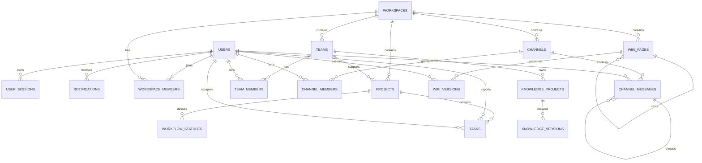
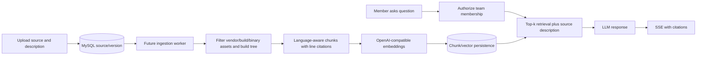

# Architecture

## Runtime modules

- `backend/app/api`: FastAPI routes and reusable authorization dependencies.
- `backend/app/api/collaboration.py`: workspace channels, one-level message threads, private-channel membership, Markdown docs, page versions, and authenticated workspace file uploads/downloads.
- `backend/app/services`: password/JWT, archive validation, notification creation, and Brevo email delivery.
- `POST /api/v1/ai/chat`: checks workspace membership, supplies bounded project/task context to the configured OpenAI-compatible chat endpoint, and returns referenced workspace records.
- `backend/app/models`: SQLAlchemy entities; `backend/app/schemas`: Pydantic contracts.
- `backend/app/db`: async SQLAlchemy engine/session.
- `backend/alembic`: migrations; `backend/app/export_openapi.py`: OpenAPI export.

## Notification email delivery

The API commits the in-app notification first, then queues an email job in a bounded Python `queue.Queue`. A dedicated background thread calls Brevo's transactional email API and retries failures up to three times with short exponential delays. The queue is process-local and volatile; pending messages can be lost on restart and are not shared across API replicas.

## Permission matrix implemented now

| Action | Owner | Admin | Member | Guest |
|---|---:|---:|---:|---:|
| List workspace resources | yes | yes | yes | yes |
| Create workspace | yes | yes | yes | yes |
| Edit workspace | yes | yes | no | no |
| Create team | yes | yes | no | no |
| Create project/task | yes | yes | yes | no |
| Edit task | yes | yes | yes | no |
| Delete task | yes | yes | no | no |
| Manage workspace settings/members | yes | yes | no | no |
| Create/edit messages | yes | yes | yes | yes |
| Edit/delete own messages | yes | yes | yes | yes |
| Moderate all channel messages | yes | yes | no | no |
| View public channels | yes | yes | yes | yes |
| View private channel | yes | yes | member only | member only |
| Manage private-channel access | yes | yes | creator only | no |
| Create/edit workspace documents | yes | yes | yes | no |
| Archive own document | yes | yes | yes | no |
| Archive any document | yes | yes | no | no |

Membership is checked before access; inaccessible workspaces return 404. Team-scoped authorization and project roles are pending.

## ER summary

Current entities include users/sessions, workspaces/members, teams/members, projects/workflows/tasks, notifications, channels/members/messages, versioned workspace documents, and knowledge project/version scaffolding. The legacy outbox table is retained to preserve existing database data but is no longer written or published. User-facing channel, message, document, workspace, team, project, task, and source rows use soft deletion where applicable.

Remaining requested entities (invitations, spaces, project members, labels, task comments, attachments, sprints, time, leave, tokens, audit, knowledge chunks/chat and reports) are tracked in `docs/ROADMAP.md`.

Private-channel reads require both workspace membership and a `channel_members` row, except workspace owners/admins who can moderate private channels. Public-channel access inherits workspace membership. Document and channel resource IDs are resolved first, then checked against the caller's workspace membership before content is returned. Message listing supports pagination and one-level threads. Docs store Markdown with a new immutable snapshot on create and each save.

## Knowledge ingestion and RAG target flow

The diagram describes the planned code knowledge/RAG pipeline; the current workspace assistant is a separate non-streaming endpoint over project/task database records. The code currently includes ZIP metadata validation only. It must be followed by bounded extraction into private staging; never use `extractall` on untrusted input. Embeddings, file retrieval, source CRUD and cited streaming chat remain roadmap work.
